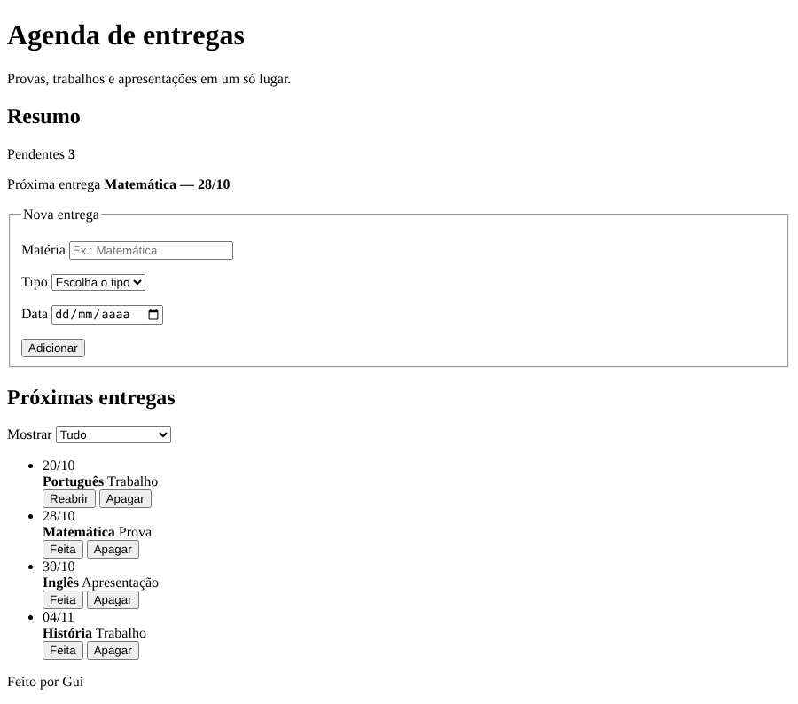

# Agenda de entregas — Etapa 1: o HTML

Hoje você vai construir um app do zero, em etapas: **Agenda de entregas**,
para organizar as provas, os trabalhos e as apresentações.

Cada etapa tem um mockup, a imagem do que precisa ser entregue. Quando terminar
uma etapa:

1. faça o commit, com a mensagem `Etapa 1` (depois `Etapa 2`, e assim por
   diante);
2. chame o professor. Ele confere e entrega a próxima etapa.

Crie um repositório novo, `agenda-de-entregas`.

---

## O que entregar

Só o `index.html`. **Nada de CSS**: nem arquivo `.css`, nem `<style>`, nem
atributo `style`. Nesta etapa, a página tem que ficar com a cara do HTML puro,
como no mockup.

---

## Requisitos

**A estrutura**

- `lang="pt-BR"` e um `<title>`.
- A página dividida em `<header>`, `<main>` e `<footer>`.
- Dentro do `<main>`, uma `<section>` para cada parte: o resumo, a nova
  entrega e a lista de entregas.
- Os títulos com `<h1>` e `<h2>`, como no mockup.
- No rodapé, o **seu** nome.

**O formulário**

- Os campos agrupados num `<fieldset>`, com a `<legend>` "Nova entrega".
- Cada campo com o seu `<label>`, ligado pelo `for`.
- Os três campos são obrigatórios (`required`).
- **Matéria:** um campo de texto, com o exemplo "Ex.: Matemática".
- **Tipo:** uma escolha entre Prova, Trabalho e Apresentação. A primeira opção
  é "Escolha o tipo", sem valor. Os valores das outras opções são `prova`,
  `trabalho` e `apresentacao`, sem acento.
- **Data:** um campo de data.

**A lista**

- Acima da lista, o campo **Mostrar**, com as opções Tudo, Só provas, Só
  trabalhos e Só apresentações. Os valores são `todos`, `prova`, `trabalho` e
  `apresentacao`.
- As quatro entregas do mockup, numa lista `<ul>`. Cada entrega tem: a data,
  a matéria em destaque (`<strong>`), o tipo, e os botões Feita e Apagar.
- **Dois combinados**, porque a etapa 2 vai precisar deles:
  - cada entrega tem o atributo `data-tipo`, com o tipo dela: `prova`,
    `trabalho` ou `apresentacao`;
  - a entrega de Português já está feita: ela tem a classe `feita`, e o botão
    dela diz "Reabrir", e não "Feita".

**As classes.** Os nomes das classes são escolha sua, mas pense na etapa 2:
tudo o que vai ter um estilo próprio precisa de uma classe.

---

## Antes de chamar o professor

- Clique no texto "Matéria": o cursor vai para o campo? Faça o mesmo com os
  outros dois.
- Clique em Adicionar com tudo vazio: aparece o aviso do navegador?
- A sua página está igual ao mockup, sem nenhum CSS?

Commit: `Etapa 1`.
