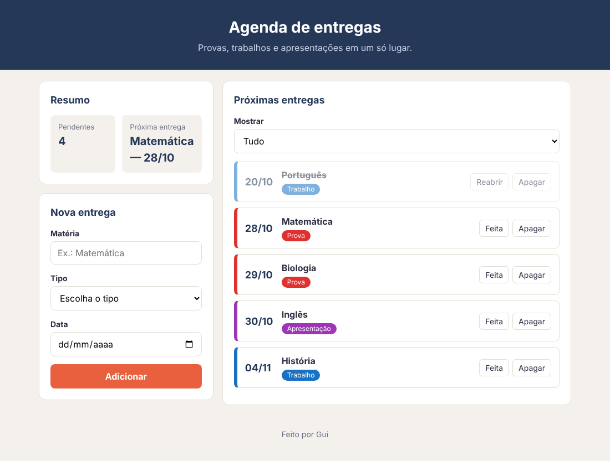

# Agenda de entregas — Etapa 3: o JavaScript

Até aqui, as quatro entregas estão escritas no HTML. Agora elas passam a viver
numa **lista no JavaScript**, e a tela é desenhada a partir dela.

## Primeiro, os dados

1. Apague do HTML as quatro entregas: o `<ul>` fica vazio.
2. No `script.js`, crie a lista com as quatro entregas, cada uma um objeto:

| matéria | tipo | data | feita |
|---|---|---|---|
| Matemática | `'prova'` | `'2026-10-28'` | `false` |
| História | `'trabalho'` | `'2026-11-04'` | `false` |
| Português | `'trabalho'` | `'2026-10-20'` | `true` |
| Inglês | `'apresentacao'` | `'2026-10-30'` | `false` |

A data fica no formato do campo de data: ano-mês-dia.

Repare que a lista **não** está em ordem de data. A tela é que vai ordenar.

---

## Requisitos

**A lista na tela**

- Uma função `renderizar()` desenha a lista inteira, com `createElement`, a
  partir da lista de entregas. Ao abrir a página, a tela fica igual ao mockup da
  etapa 2.
- A lista aparece **sempre em ordem de data**, da mais próxima para a mais
  distante. A lista de entregas continua na ordem em que as entregas entraram.
- A data aparece como `28/10`.
- Cada entrega tem o `data-tipo` dela. A entrega feita tem a classe `feita`, e
  o botão dela diz "Reabrir".

**Adicionar**

- O formulário adiciona uma entrega nova, que começa **não feita**.
- Depois de adicionar, o formulário volta ao começo.
- Uma matéria feita só de espaços não entra.

**Apagar**

- O botão Apagar tira **aquela** entrega. Cuidado: a tela está em ordem de
  data, e a lista, não.

**O resumo**

- **Pendentes:** quantas entregas ainda não foram feitas.
- **Próxima entrega:** a matéria e a data da entrega pendente mais próxima. Se
  não houver nenhuma pendente, aparece "Nada pendente".

O botão Feita e o campo Mostrar ainda não precisam funcionar: eles são da
etapa 4.

---

## O teste

Adicione **Biologia, Prova, 29/10/2026**. A tela tem que ficar assim:

- A Biologia entrou **entre** a Matemática e o Inglês.
- Pendentes: 4.
- A próxima entrega continua sendo a Matemática.

Depois, apague o Inglês: sai o Inglês, e os pendentes voltam para 3. No
console, a sua lista de entregas tem que bater com a tela.

Commit: `Etapa 3`.
