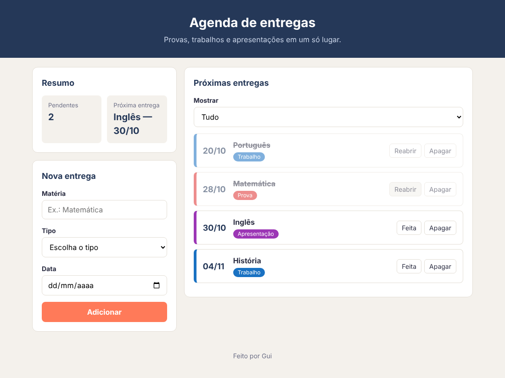
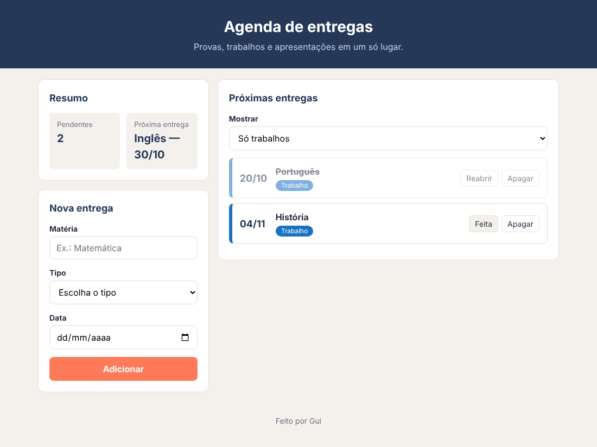

# Agenda de entregas — Etapa 4: feita, filtro e salvar

A última etapa: os dois controles que faltam e a agenda guardada no navegador.

---

## Requisitos

**Marcar como feita**

- O botão Feita marca a entrega como feita: ela fica apagada e riscada, e o
  botão passa a dizer "Reabrir".
- O botão Reabrir faz o caminho de volta.
- O resumo acompanha: os pendentes e a próxima entrega mudam na hora.

Marcando a Matemática como feita, a tela fica assim:

**O filtro**

- O campo Mostrar mostra só as entregas do tipo escolhido, ainda em ordem de
  data.
- O resumo **não** muda com o filtro: ele conta todas as entregas.

Com "Só trabalhos":

**Salvar no navegador**

- As entregas ficam salvas no `localStorage`, com uma chave só deste projeto,
  como `'agenda-de-entregas'`.
- Na primeira vez que a página abre, sem nada salvo, ela começa com as quatro
  entregas de exemplo.
- Adicionar, apagar e marcar como feita: tudo continua lá depois de recarregar
  a página.

---

## O teste

1. Marque a Matemática como feita. Pendentes: 2. Próxima entrega: Inglês —
   30/10.
2. Escolha "Só trabalhos": aparecem só o Português e a História.
3. Recarregue a página: a Matemática continua feita.
4. Na aba Application do DevTools, apague a chave e recarregue: as quatro
   entregas de exemplo voltam, como no começo.

Commit: `Etapa 4`.

---

## Se sobrar tempo

- **As feitas no fim.** As entregas feitas vão para o fim da lista, e as
  pendentes ficam em cima, em ordem de data.
- **Esconder as feitas.** Uma caixa de marcar "Esconder as feitas".
- **Por tipo.** No resumo, quantas provas, quantos trabalhos e quantas
  apresentações estão pendentes.
- **Lembrar o filtro.** O filtro escolhido também fica salvo.
